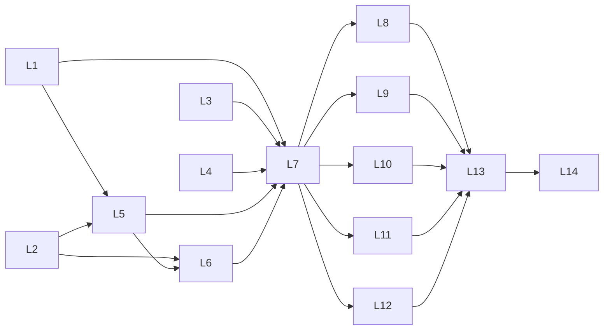

# Plan : portage d'IBD Journal en site web réactif (Netlify, offre gratuite)

Document de pilotage destiné à des agents d'exécution. Chaque lot (`L…`) est autonome : fichiers cibles, travail, critères d'acceptation. Les lots d'une même vague peuvent tourner en parallèle.

---

## 0. Décisions d'architecture (figées)

| Sujet | Décision | Raison |
|---|---|---|
| Emplacement | Nouveau dossier `web/` à la racine. On ne modifie pas `app/` ni `shared/`. | L'app Android reste la référence fonctionnelle. |
| Stack | **Vite + TypeScript (strict) + Preact + `@preact/signals`**. CSS natif, sans framework CSS. | Bundle léger (~10 Ko pour le runtime), JSX familier aux agents. Les guides modern-web-guidance sont en HTML/CSS/JS natif et s'appliquent directement. |
| Logique métier | **Portage manuel en TypeScript** de `shared/src/commonMain` (~1 600 lignes). Les tests `shared/src/commonTest` sont portés vers **Vitest** et servent d'oracle de parité. | Room (la base KMP) n'a pas de cible JS. Kotlin/Wasm + Compose Web produirait un canvas peu accessible et lourd, à l'opposé des guidelines. |
| Stockage | **IndexedDB** via `idb`. Un object store par table Room (`meals`, `stools`, `products`, `lab_results`, `dose_logs`, `profile`, `medications`, `checkups`, `exams`) avec les mêmes index. Les préférences (équivalent `AppPrefs`) vont dans un store `prefs`. Appeler `navigator.storage.persist()` au démarrage. | Données locales uniquement, comme sur Android. |
| Dates | **Temporal** (`PlainDate`, `PlainTime`, `PlainDateTime`) + `temporal-polyfill` chargé dynamiquement si `typeof Temporal === 'undefined'` (Safari). Persistance identique à Android : `dateEpochDay` (nombre) et `epochMillis`. | Guide `capture-location-agnostic-data`. Format d'export compatible. |
| Sauvegarde | Format **binaire identique** à `BackupCrypto.kt` : `IBDJENC1` + itérations (int32 BE) + sel 16 o + IV 12 o + AES-256-GCM (tag 128 bits), clé PBKDF2-HMAC-SHA256, l'en-tête complet sert d'AAD. Clair = JSON `BackupData` (mêmes noms de champs, `ignoreUnknownKeys`). Implémentation en WebCrypto. | **Migration téléphone → web sans perte** : une sauvegarde Android s'importe sur le web, et inversement. |
| Rappels | Les alarmes Android n'ont pas d'équivalent web fiable sans serveur. Remplacement : (1) carte « À faire aujourd'hui » à l'ouverture (bilan du soir, doses dues, étapes d'examen) ; (2) **export `.ics`** avec `VALARM` (remplace la synchro calendrier) ; (3) `Notification` locale uniquement quand l'onglet ou la PWA est ouvert. **Pas de Web Push** : il faudrait un serveur qui connaisse l'agenda médical, ce qui contredit le modèle de confidentialité. | Confidentialité, gratuité Netlify. |
| Rapport médecin | Route `/report` avec feuille de style `@media print` et bouton « Imprimer / Enregistrer en PDF » (`window.print()`). Pas de librairie PDF. | Zéro dépendance, accessible, contenu équivalent à `ReportPdfBuilder.kt`. |
| Import PDF labo | **`pdfjs-dist`** dans un Web Worker : `getTextContent()` → reconstruction de `TextLine(text, left, top, right, bottom, page)` (même contrat que `LabReportReader.kt`) → `parseLabReport` porté. | 100 % local, comme PdfBox-Android. |
| Code-barres | `BarcodeDetector` si disponible, sinon **`zxing-wasm`** chargé à la demande ; saisie manuelle toujours possible. Requête Open Food Facts `GET https://world.openfoodfacts.org/api/v2/product/{code}.json` (CORS autorisé). | Parité ZXing sans dépendance Google. |
| Photos de repas | `<input type="file" accept="image/*" capture="environment">`, réduction via `createImageBitmap` + `OffscreenCanvas` (max 1280 px, WebP), Blob stocké dans IndexedDB. Hors sauvegarde, comme sur Android. | |
| i18n | Script de build qui convertit `app/src/main/res/values*/strings*.xml` en `web/src/i18n/{en,fr,de,es,it,pt}.json` (chaînes, `plurals` → `Intl.PluralRules`, `%1$s`/`%d` → placeholders nommés). Dates et nombres via `Intl`. Langue : préférence utilisateur, sinon `navigator.languages`. | Une seule source de traductions. |
| Thèmes | `Palettes.kt` → variables CSS par palette, `color-scheme: light dark` + `light-dark()`, choix clair / sombre / système / AMOLED. | Guides `dark-mode`, `dark-mode-toggle`, `browser-ui-theming`. |
| PWA | `vite-plugin-pwa` (Workbox) : précache de l'app shell, fonctionnement hors ligne, `manifest.webmanifest`, installable. | Guide `install-web-app`. |
| Hébergement | Netlify, site statique, **aucune Function**. `netlify.toml` : base `web`, build `npm run build`, publish `dist`, redirection SPA `/* /index.html 200`, en-têtes de sécurité. | Offre gratuite suffisante (statique). |
| Licence | AGPL-3.0 : un service en ligne doit proposer son code source. Lien « Code source » visible dans Réglages et dans le pied de page. | Obligation légale. |

### Exigences des guides modern-web-guidance

Chaque agent qui écrit de l'UI **doit** d'abord exécuter (cf. `.agents/skills/modern-web-guidance/SKILL.md`) :
```sh
npx -y modern-web-guidance@latest search "<requête>" --skill-version 2026_11_10-47b4c80e
npx -y modern-web-guidance@latest retrieve "<id>"
```
Guides déjà identifiés, par lot :

| Lot | IDs à récupérer |
|---|---|
| Shell / navigation | `navbar`, `responsive-design`, `form-factor-adaptation`, `same-document-transitions`, `css-layout`, `css`, `html` |
| Feuilles / dialogues | `dialog`, `light-dismiss-a-dialog`, `platform-controls-dismiss-dialog`, `prevent-page-scroll-under-modal-dialog`, `declarative-dialog-popover-control` |
| Formulaires | `forms`, `validate-input-after-interaction`, `brand-consistent-forms` |
| Thèmes | `dark-mode`, `dark-mode-toggle`, `browser-ui-theming` |
| Tableaux / graphiques | `responsive-table`, `accessibility` |
| Toasts | `persistent-toast-notifications` |
| Onglets (Soins / Labos) | `tabs` |
| Dates | `capture-location-agnostic-data`, `calculate-event-differentials` |
| PWA / perf | `install-web-app`, `performance`, `identify-inp-causes` |
| Sécurité / vie privée | `security`, `privacy`, `trusted-types` |
| Onboarding | `persistent-app-tours` (seulement si l'onboarding utilise des bulles ancrées) |

Politique navigateurs : Baseline « Widely available » sans fallback ; tout le reste suit le fallback du guide (ex. Temporal → polyfill). **Ne pas** utiliser `restrict-outbound-connections` (fonctionnalité « volatile », non activée) : la restriction réseau passe par la CSP `connect-src`.

Chaque PR/lot se termine par une section `### Modern Web Guidance` listant les guides appliqués (format défini dans le SKILL.md).

---

## 1. Correspondance Android → Web

| Android | Web |
|---|---|
| `MainActivity` + `NavigationBar` (5 onglets : home, history, analysis, care, settings) | `<nav>` : barre en bas sous 600px, rail latéral au-dessus (container/media queries) ; routeur History API |
| Routes `home`, `history`, `day/{date}`, `analysis`, `care`, `care/labs`, `settings` | `/`, `/history`, `/day/:yyyy-mm-dd`, `/analysis`, `/care`, `/care/labs`, `/settings`, + `/onboarding`, `/report`, `/scan` |
| `ModalBottomSheet` (`StoolSheet`, `MealEditorSheet`, `HomeSheets`, `TreatmentEditors`, `ExamEditors`) | `<dialog>` modal, style « feuille » en bas sur mobile, centré sur grand écran |
| ViewModels + `StateFlow` | Stores `@preact/signals` par écran (`web/src/state/*.ts`) |
| Room DAOs (`Daos.kt`, `ExamStore.kt`) | `web/src/db/*.ts` : mêmes requêtes, mêmes tris |
| DataStore (`AppPrefs.kt`) | store `prefs` + signal réactif |
| `NotificationHelper` / `TreatmentReminderScheduler` / `NotificationReceiver` | `web/src/reminders/` : calcul des échéances (`ReminderSchedule.nextOccurrence`, `ExamPlan`) → carte du jour + `.ics` + `Notification` si l'app est ouverte |
| `CalendarSync` / `PhoneCalendar` | Export `.ics` (traitements, contrôles, étapes d'examen) |
| `ReportPdfBuilder` | `/report` + CSS d'impression |
| `LabReportReader` (PdfBox) | Worker `pdfjs-dist` → `TextLine[]` |
| `BarcodeAnalyzer` (CameraX + ZXing) | `getUserMedia` + `BarcodeDetector` / `zxing-wasm` |
| `OpenFoodFactsApi` (Retrofit) | `fetch` + cache `products` |
| `BackupCrypto` + `DataBackupManager` | `web/src/backup/` (WebCrypto, format identique) |
| `res/drawable/ic_bristol_*.xml` | `tools/bristol-svg/*.svg` (déjà disponibles) → `web/public/icons/` |
| `Palettes.kt`, `Theme.kt`, `BristolColors.kt` | `web/src/styles/palettes.css`, `tokens.css` |

---

## 2. Arborescence cible

```
web/
  index.html
  package.json  tsconfig.json  vite.config.ts  vitest.config.ts
  netlify.toml            (ou à la racine, avec base = "web")
  public/  icons/ (bristol, app, maskable)  robots.txt
  scripts/strings-to-json.ts
  src/
    main.tsx  app.tsx  router.ts
    domain/      models.ts analysis.ts adherence.ts time.ts examPlan.ts calendarEvents.ts
                 labReference.ts labReportParser.ts standardMedications.ts health.ts profile.ts
    db/          schema.ts (version, upgrade) meals.ts stools.ts labs.ts doses.ts profile.ts
                 medications.ts checkups.ts exams.ts products.ts prefs.ts
    backup/      crypto.ts backup.ts
    i18n/        index.ts  en.json fr.json de.json es.json it.json pt.json (générés)
    reminders/   schedule.ts ics.ts today.ts notify.ts
    labimport/   pdfText.worker.ts reader.ts
    scanner/     detector.ts openFoodFacts.ts
    state/       un store par écran
    ui/          components/ (Dialog, Sheet, Scale0to5, BristolPicker, Toast, Chart, Table…)
                 screens/ (Home, History, Day, Analysis, Care, Labs, Settings, Onboarding, Report, Scan)
    styles/      reset.css tokens.css palettes.css layout.css print.css
  test/          portages de shared/src/commonTest + tests web (crypto, db, ics)
```

---

## 3. Lots de travail

### Vague 1 (parallèle, pas de dépendance)

**L1 : socle et déploiement**
- Créer `web/` (Vite + Preact + TS strict, ESLint minimal, Vitest), `netlify.toml` :
  - `[build] base="web" command="npm ci && npm run build" publish="dist"`, `NODE_VERSION` LTS ;
  - `[[redirects]] from="/*" to="/index.html" status=200` ;
  - en-têtes : `Content-Security-Policy: default-src 'self'; script-src 'self' 'wasm-unsafe-eval'; worker-src 'self' blob:; connect-src 'self' https://world.openfoodfacts.org; img-src 'self' blob: data: https://images.openfoodfacts.org; style-src 'self'; object-src 'none'; base-uri 'none'; frame-ancestors 'none'; require-trusted-types-for 'script'`, plus `Referrer-Policy: no-referrer`, `Permissions-Policy: camera=(self), geolocation=(), microphone=()`, `X-Content-Type-Options: nosniff`, cache immuable sur `/assets/*`.
- `.gitignore` racine (le dossier n'est pas encore un dépôt git) : `keystore/`, `keystore.properties`, `local.properties`, `Labos/`, `build/`, `web/node_modules`, `web/dist`.
- Acceptation : `npm run build` produit `dist/` ; `npx netlify deploy --dir=web/dist` (brouillon) sert une page ; aucun fichier hors `web/dist` publié.

**L2 : portage du domaine + tests**
- Porter `shared/src/commonMain/**` en TS dans `web/src/domain/` (enums en unions de chaînes avec les **mêmes noms** que Kotlin, car ce sont les valeurs stockées et sauvegardées ; `LabTest` garde son ordre, son unité et sa catégorie).
- Porter les 5 fichiers de `shared/src/commonTest` vers Vitest, à l'identique (mêmes entrées, mêmes attentes).
- Acceptation : `npm test` vert ; aucune dépendance au DOM dans `domain/`.

**L3 : i18n**
- `scripts/strings-to-json.ts` (lancé en `prebuild`) : lit les 6 locales × 16 fichiers `strings*.xml`, gère `<plurals>`, échappements Android (`\'`, `\n`, `&amp;`), placeholders `%1$s`/`%d`/`%.1f`.
- `src/i18n/index.ts` : `t(key, params)`, `tp(key, count, params)` via `Intl.PluralRules`, signal de langue, `<html lang>` mis à jour.
- Ignorer les chaînes propres à Android (permissions, canaux de notification, calendrier téléphone) ; ajouter les nouvelles chaînes web (export `.ics`, impression, installation, code source) dans les 6 langues.
- Acceptation : test qui vérifie que chaque clé `en` existe dans les 5 autres langues ; le build échoue si une clé utilisée dans `src/` manque.

**L4 : design system**
- `tokens.css`, `palettes.css` (traduire `Palettes.kt` : tons clair/sombre par palette, variante AMOLED), typographie système, espacements, cibles tactiles ≥ 44 px.
- Composants : `Dialog`/`Sheet` (natif `<dialog>`, Échap, retour arrière mobile, light dismiss, blocage du scroll de fond), `Scale0to5` (radio group), `BristolPicker` (0–7, icônes SVG + couleurs `BristolColors.kt`), `Toast`, `Switch`, `SegmentedControl`, `EmptyState`.
- Guides : voir tableau §0.
- Acceptation : page `/dev/components` (exclue du build prod) montrant chaque composant en clair et sombre ; navigation complète au clavier ; contraste AA.

### Vague 2 (après L1 + L2)

**L5 : couche données**
- `db/schema.ts` : base `ibd-journal` v1 avec les 9 stores, clés auto-incrémentées où Room les a, index (`dateEpochDay`, `[test, dateEpochDay]`, `[medicationId, scheduledAt]` unique).
- Repositories équivalents aux DAOs (lecture par plage de jours, par mois, upsert, suppression en cascade logique comme Android).
- Signal de changement par store, pour rafraîchir les écrans (équivalent des `Flow` Room).
- Acceptation : tests Vitest avec `fake-indexeddb` sur CRUD + requêtes par plage.

**L6 : sauvegarde chiffrée compatible Android**
- `backup/crypto.ts` : `encrypt(json, password)` / `decrypt(bytes, password)` via `crypto.subtle` (PBKDF2 600 000 itérations, plafond 10 000 000 en lecture, AES-GCM, AAD = en-tête). Erreurs distinctes « mauvais mot de passe » / « fichier invalide ».
- `backup/backup.ts` : `snapshot()` et `restore()` dans **une seule transaction** IndexedDB, avec la sémantique de `Backup.kt` (sections absentes conservées, ids des traitements conservés).
- Export : téléchargement `ibd-journal-AAAA-MM-JJ.ibdj`. Import : `<input type=file>`.
- Acceptation : test aller-retour ; **test de vecteur croisé** : fichier produit par l'app Android (fourni manuellement, mot de passe connu, données fictives), déchiffré et restauré à l'identique.

**L7 : shell, routeur, onboarding, réglages**
- `app.tsx` : navigation responsive (5 destinations), titres de page, View Transitions entre écrans (amélioration progressive), redirection vers `/onboarding` si le profil n'existe pas (logique de `MainViewModel`/`OnboardingViewModel`).
- `Settings` : profil (`ProfileSection`), apparence (palette, mode, langue), rappel du soir (heure), sauvegarde/restauration (L6), export `.ics` (L11), confidentialité (`strings_privacy`), « Installer l'app », lien code source AGPL, avertissement médical.
- Acceptation : parcours onboarding → accueil ; changement de langue et thème immédiat et persistant ; utilisable de 320 px à 1920 px.

### Vague 3 (après L4 + L5 + L7 ; lots parallèles entre eux)

**L8 : Accueil + journal des selles** (`HomeScreen.kt`, `HomeSheets.kt`, `StoolSheet.kt`, `DiaryEditors.kt`, `TodayDosesViewModel.kt`, `CheckInScale.kt`, `strings_false_urge`, `strings_checkin`)
- Saisie en deux gestes : Bristol 0–7, sang, mucus, douleur, fatigue (0–5), urgence, nocturne, commentaire ; fausses envies enregistrées à part.
- Carte « Bilan du soir » (remplace la notification interactive) : type, douleur, fatigue, avec la logique `DailyCheckIn.complete`.
- Doses du jour : pris / oublié (écrit `dose_logs`).
- Acceptation : création/édition/suppression d'une selle, comptage identique à Android (fausses envies exclues).

**L9 : Historique + jour + repas** (`HistoryScreen.kt`, `DayScreen.kt`, `CalendarViewModel.kt`, `MealEditorSheet.kt`)
- Calendrier mensuel coloré par consistance (grille CSS, navigation clavier par flèches), vue jour.
- Repas : type, description, photo (réduite, Blob), produit par code-barres (lien vers L12).
- Acceptation : un mois de données de test s'affiche avec les bonnes couleurs ; navigation mois précédent/suivant ; lecteur d'écran annonce date + résumé.

**L10 : Tendances + rapport** (`AnalysisScreen.kt`, `DailyStoolChart.kt`, `Analysis.kt`, `ReportData.kt`, `ReportPdfBuilder.kt`, `strings_report`)
- Périodes 30 j / 90 j / tout ; selles par jour en **SVG inline** (pas de lib de graphiques), comparaison avec la période précédente, tableau de données alternatif accessible.
- `/report` : contenu de `ReportData` (période, symptômes, traitements + observance, derniers bilans avec les normes du labo), `print.css` (A4, sauts de page, pas de navigation).
- Acceptation : chiffres identiques aux fonctions de `Analysis.kt` portées ; aperçu d'impression Chrome/Firefox/Safari propre sur 1–3 pages.

**L11 : Soins : traitements, contrôles, examens, rappels** (`CareScreen.kt`, `TreatmentEditors.kt`, `ExamEditors.kt`, `CareViewModel.kt`, `StandardMedications.kt`, `Adherence.kt`, `ExamPlan.kt`, `CalendarEvents.kt`, `strings_exams`, `strings_exam_reminders`, `strings_adherence`)
- Traitements (liste standard des médicaments MICI, posologie, récurrence, alerte de renouvellement, observance), prises de sang/selles programmées, coloscopie/rectosigmoïdoscopie (régime sans résidus, doses de préparation, consultation d'anesthésie).
- `reminders/` : prochaines échéances via `ReminderSchedule`/`ExamPlan` portés ; carte « À faire » sur l'accueil ; `Notification` affichée pendant que l'app est ouverte (permission demandée au clic, jamais au chargement) ; **export `.ics`** (RFC 5545 : `VEVENT` + `RRULE` + `VALARM`, `TZID` IANA de l'utilisateur), en reprenant l'avertissement de confidentialité de `CalendarSection.kt`.
- Acceptation : tests Vitest des échéances (portage `ExamPlanTest`) et d'un `.ics` importé dans Google Agenda / Apple Calendrier.

**L12 : Résultats de labo + import PDF + scanner** (`LabsScreen.kt`, `LabResultsUi.kt`, `LabImportUi.kt`, `LabReportReader.kt`, `LabFormat.kt`, `ScannerScreen.kt`, `ScannerViewModel.kt`, `BarcodeAnalyzer.kt`, `OpenFoodFactsApi.kt`, `strings_lab*`)
- Labos : 43 tests par catégorie, saisie avec qualificatif (`<`, `>`) et normes du labo, graphique SVG avec bande de référence, tableau des bilans sanguins (guide `responsive-table` : en-têtes figés, défilement horizontal).
- Import PDF multiple : worker pdf.js → `TextLine[]` (coordonnées en points, origine en haut à gauche, comme PdfBox) → `parseLabReport` → écran de revue ; **rien n'est enregistré avant validation**. PDF scannés : message « non pris en charge ».
- Scanner : `getUserMedia({video:{facingMode:'environment'}})`, `BarcodeDetector` ou `zxing-wasm`, saisie manuelle, fiche produit OFF mise en cache.
- Acceptation : en local, les PDF de `Labos/` donnent les mêmes résultats que l'app Android (**ne jamais copier ces fichiers dans `web/`, les tests ni un commit** : données de santé réelles) ; tests automatisés avec les `TextLine` déjà anonymisés de `LabReportParserTest.kt`.

### Vague 4 (après tout)

**L13 : PWA, performance, accessibilité, sécurité**
- `vite-plugin-pwa` : manifest (nom, icônes depuis `ic_launcher_foreground.svg`, `display: standalone`, `theme_color` par palette), précache, page hors ligne, invite d'installation (`install-web-app`).
- Découpage du code : pdf.js, zxing-wasm et Temporal polyfill chargés à la demande ; budget JS initial < 120 Ko gz.
- Audit Lighthouse mobile ≥ 95 sur les 4 catégories ; axe-core sans violation ; tests Playwright des parcours clés (onboarding, selle, export/import, impression rapport) sur Chromium, Firefox, WebKit.
- Vérification CSP en production (aucune violation console), Trusted Types actif.

**L14 : documentation et mise en ligne**
- `web/README.md` (dev, build, déploiement), section « Version web » dans `README.md` et les 5 traductions de `docs/i18n/`.
- Déploiement Netlify : `git init` + dépôt GitHub/GitLab connecté à Netlify (déploiements de prévisualisation sur PR), ou `netlify deploy --prod` via CLI.
- Acceptation : URL publique fonctionnelle, installable, utilisable hors ligne après la première visite.

---

## 4. Dépendances



Vague 1 : 4 agents. Vague 2 : L5 → L6 en série, L7 en parallèle sur l'UI (il branche L6 à la fin). Vague 3 : 5 agents. Fichiers partagés en vague 3 : `app.tsx`/`router.ts` (un seul propriétaire : L7 déclare toutes les routes avec des écrans vides), `i18n/*.json` (générés, pas édités à la main), `db/` (propriétaire L5 ; les autres lots demandent les ajouts).

---

## 5. Règles communes pour les agents

- La référence fonctionnelle est le code Kotlin cité dans chaque lot : lire l'écran **et** son ViewModel avant de coder.
- Aucune donnée ne quitte le navigateur, sauf la requête Open Food Facts (code-barres seul). Pas d'analytics, pas de polices ni de CDN externes, pas de cookies.
- `innerHTML` interdit (Trusted Types) ; le texte vient de JSX.
- Valeurs persistées (enums, `dateEpochDay`, noms de champs) **identiques** à Android, sinon la compatibilité des sauvegardes est perdue.
- L'app ne donne pas de valeurs normales et n'interprète rien (cf. avertissement du README) : ne rien ajouter de ce genre.
- Ne jamais lire, copier ni publier `keystore/`, `keystore.properties`, `local.properties`, `Labos/`.
- Chaque lot livre : code + tests Vitest de sa logique + section `### Modern Web Guidance`.

## 6. Écarts assumés par rapport à Android

| Fonction Android | Web | Impact |
|---|---|---|
| Notification du soir interactive, rappels de doses en arrière-plan | Carte à l'ouverture + `.ics` + notification seulement app ouverte | Pas de rappel si l'app est fermée, sauf via le calendrier (`.ics`). |
| Synchro directe avec le calendrier du téléphone | Export `.ics` (à refaire après modification) | Manuel. |
| PDF partagé directement | Impression / « Enregistrer en PDF » du navigateur | Une étape de plus. |
| Données dans le sandbox Android | IndexedDB du navigateur (peut être effacée si l'utilisateur vide les données du site) | Inciter à des exports chiffrés réguliers (rappel dans Réglages). |
| Scanner code-barres partout | Safari/Firefox : fallback wasm, plus lent | Acceptable. |
